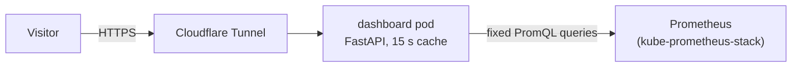

# homelab-dashboard

[](https://github.com/turpinator-x/homelab-dashboard/actions/workflows/ci.yaml)

A live, public status page for my two-node k3s homelab: **https://dashboard.jarrodturpin.dev**

It shows CPU and memory use across the cluster, running pods, node health and uptime, and whether each self-hosted app is up. The numbers refresh every 15 seconds.

## How it works



- **Backend** (`main.py`): a small FastAPI app. It sends a fixed set of PromQL queries to the cluster's Prometheus in parallel, caches the answers for 15 seconds, and serves them as JSON at `/api/stats`. If Prometheus is unavailable, it keeps serving the last good numbers. If it has none yet, it returns 503.
- **Frontend** (`static/index.html`): one static page, with no framework and no third-party scripts or fonts. It polls `/api/stats`.
- **Deployment:** the Kubernetes manifests live in my GitOps repo, [turpinator-x/homelab](https://github.com/turpinator-x/homelab), and Flux deploys them.

## Security choices

The page is public, so it's built to expose as little as possible:

- **Visitors can't send queries.** The PromQL is fixed in the code. Visitors only read cached results, so a flood of traffic costs at most one round of queries every 15 seconds.
- **Only totals are shown.** There are no pod names, IPs or internal hostnames.
- **No Kubernetes API access.** The data comes from Prometheus, so the pod runs with no service account token.
- **Locked-down container:**
  - non-root (UID 10001)
  - read-only root filesystem
  - all Linux capabilities dropped
  - seccomp `RuntimeDefault`
  - no automatic API docs (`/docs` is off)
- **Locked-down network:** a NetworkPolicy allows traffic in only from the tunnel's pods, and out only to DNS and Prometheus.
- **Supply chain:**
  - GitHub Actions are pinned to commit SHAs.
  - Images are published with the workflow's short-lived token, not a stored password.
  - Images ship with build provenance and an SBOM.

## Run it locally

Needs [uv](https://docs.astral.sh/uv/) and access to a Prometheus.

```bash
kubectl -n monitoring port-forward svc/kube-prometheus-stack-prometheus 9090:9090   # in another terminal
PROMETHEUS_URL=http://localhost:9090 uv run uvicorn main:app --reload
```

Then open http://localhost:8000.

| Setting | Default | Meaning |
|---|---|---|
| `PROMETHEUS_URL` | the in-cluster Prometheus Service | Where to send queries |
| `CACHE_SECONDS` | `15` | How long one round of answers is reused |
| `APPS` | `linkding,audiobookshelf` | Deployments to show as up or down |

## Tests and CI

```bash
uv run ruff format --check . && uv run ruff check . && uv run pytest
```

The tests replace the Prometheus call with a fake one, so they need no cluster. They cover the health check, the response shape, app up/down, the cache, and the 503 path.

On every push and pull request, GitHub Actions runs the same checks, then builds the image for `linux/amd64` and `linux/arm64` (the cluster has a mini PC and a Raspberry Pi 5). Pushing a `v*` tag publishes the image to `ghcr.io/turpinator-x/homelab-dashboard` with that version.

## Built with AI assistance

I wrote the backend (`main.py`) myself, with [Claude Code](https://claude.com/claude-code) as a tutor explaining each piece. Claude Code generated the frontend (`static/index.html`), and drafted the tests, Dockerfile and CI workflow, which I reviewed and typed in.

The project idea comes from the KubeCraft community.
